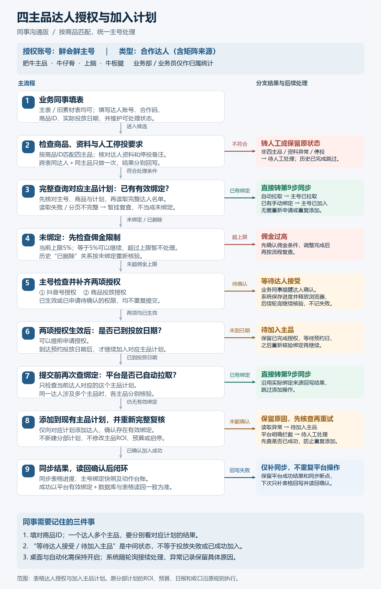
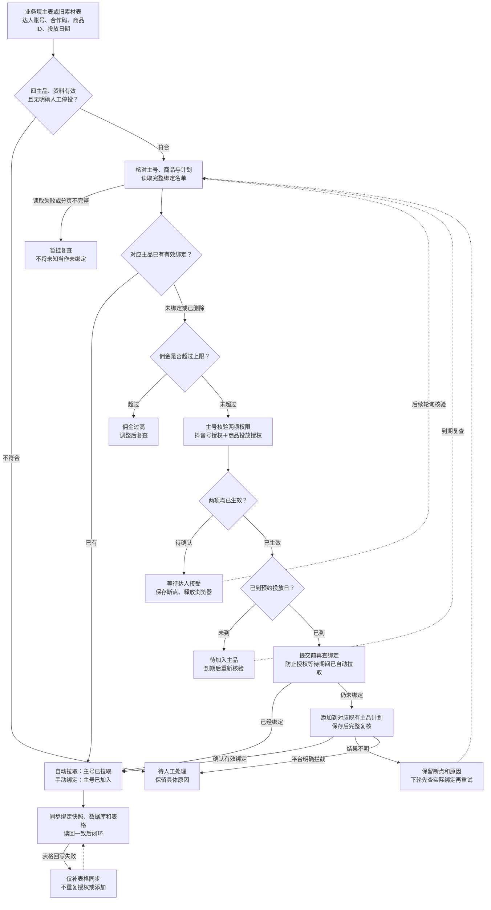

# 四主品达人授权与加入计划：同事沟通版

建议转发 `main-account-flow.png`；打印或发送文档可使用 `main-account-flow.pdf`。`main-account-flow.svg` 为可编辑矢量图，`render_flow.py` 可重新生成图片。



业务同事负责填写达人资料、商品ID、投放日期和停投要求，授权等待时提醒达人确认。系统按商品ID核验对应主品的实际绑定，未绑定时统一使用鲜会鲜主号、合作达人类型，补齐权限后加入既有计划，并复核、落库和回写表格。

## 商品与计划对应

主号：鲜会鲜，`1762338766025739`。业务部、业务员只用于归属统计。矩阵来源与普通来源使用相同主号合作达人流程。

| 主品 | 商品ID | 既有主号计划ID |
| --- | --- | --- |
| 肥牛主品 | `3625226808611490412` | `1839594740761991` |
| 牛仔骨 | `3634294397346170956` | `1876932727172643` |
| 上脑 | `3735391724588106065` | `1876932571532615` |
| 牛板腱 | `3562896022277644951` | `1876929956358355` |

## 可编辑流程



## 需要对齐的规则

- 当前佣金上限为5%，等于5%允许继续；实际阈值由本机配置决定。
- 同达人、同主品跨表只操作一次，关联记录分别回写；同达人多个主品分别处理。
- 已有效绑定直接同步完成；历史分部已投放或已完成记录不自动重新接管。
- 等待达人接受、待加入主品是中间状态；真实新增成功必须确认对应主品内的有效绑定。
- 系统需要桌面及自动化保持开启。等待确认时保存断点并释放浏览器，随轮询接续处理。
- 本流程仅处理达人授权与加入主品计划；主品计划ROI、预算及启停参数保持原值，原分部日报和收口沿原规则执行。

## 图片生成

在仓库根目录运行（需要 Pillow 与 Windows 微软雅黑字体）：

```powershell
python docs/main-account-migration/shareable-flow/render_flow.py
```
